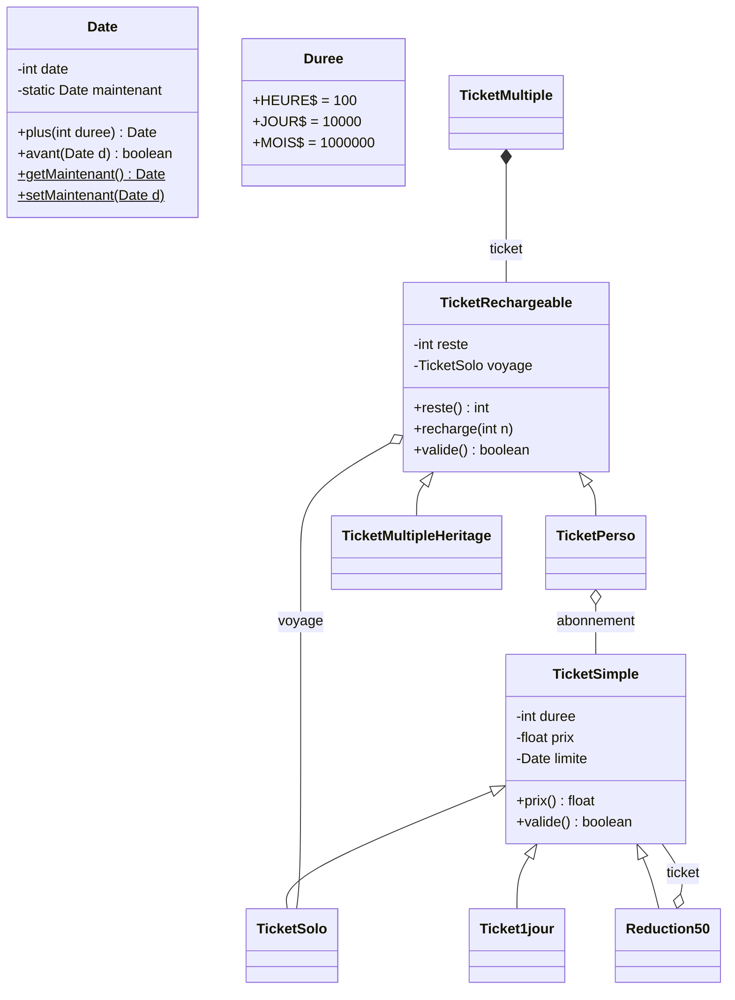

# 🎫 Public Transport Ticketing System — Object-Oriented Design in Java

A Java model of a public transport ticketing system: single-trip tickets, day passes, rechargeable multi-trip cards, monthly subscriptions and discounts.

The project was built for the **Programming & Software Design** course at **Aix-Marseille University**. It shows core **object-oriented design** principles:

- **Inheritance** and **method overriding**
- **Composition** and **delegation**
- The **Decorator** design pattern
- **Inheritance vs. composition** trade-offs and the **Liskov Substitution Principle**

> The source code identifiers are in French (the course language). The table below gives the English meaning of each one.

---

## 📁 Project Structure

```
.
├── src/
│   ├── Date.java                    # Simulated clock with a global "now"
│   ├── Duree.java                   # Duration constants: HOUR, DAY, MONTH
│   ├── TicketSimple.java            # Base ticket: duration + price + expiry date
│   ├── TicketSolo.java              # Single-trip ticket (1 hour, €1.50)
│   ├── Ticket1jour.java             # Day pass (€5.00)
│   ├── Reduction50.java             # Decorator: 50% discount on any ticket
│   ├── TicketRechargeable.java      # Rechargeable card holding n trips
│   ├── TicketMultiple.java          # Non-rechargeable card (via composition)
│   ├── TicketMultipleHeritage.java  # Non-rechargeable card (via inheritance)
│   ├── TicketPerso.java             # Personal card: subscription + trips
│   └── TestTicket.java              # Test program (main)
├── .gitignore
└── README.md
```

---

## 🧩 Class Diagram



---

## 📖 Classes

| Class | English meaning | Responsibility |
|---|---|---|
| `Date` | Date | A point in time stored as an integer. A static `maintenant` ("now") simulates the current clock, so tests are deterministic. |
| `Duree` | Duration | Constants `HEURE` (hour), `JOUR` (day) and `MOIS` (month). |
| `TicketSimple` | Simple ticket | Base ticket. The first `valide()` (validate) sets the expiry to `now + duration`. After that, it stays valid until the expiry date. |
| `TicketSolo` | Single ticket | One trip, valid for 1 hour, €1.50. |
| `Ticket1jour` | Day pass | Valid for one day, €5.00. |
| `Reduction50` | 50% discount | Wraps an existing ticket, halves its price and passes validation to the wrapped ticket (**Decorator** pattern). |
| `TicketRechargeable` | Rechargeable card | Holds `n` trips. Each validation uses one trip (a new `TicketSolo`), unless the current trip is still valid. Can be recharged. |
| `TicketMultiple` | Multi-trip card | **Non-rechargeable**, built by **composition**: it wraps a `TicketRechargeable` and does not expose `recharge()`. |
| `TicketMultipleHeritage` | Multi-trip card (inheritance) | **Non-rechargeable**, built by **inheritance**: `recharge()` is overridden to do nothing. |
| `TicketPerso` | Personal card | Combines a subscription (`abonnement`) and rechargeable trips. Valid while the subscription is active, otherwise it uses a trip. |

### 💡 Inheritance vs. Composition

`TicketMultiple` and `TicketMultipleHeritage` meet the same need: a multi-trip card that cannot be recharged.

- **Composition** (`TicketMultiple`): `recharge()` does not exist, so it cannot be called by mistake. ✅
- **Inheritance** (`TicketMultipleHeritage`): `recharge()` still exists but silently does nothing. Code that uses it as a `TicketRechargeable` gets surprising behaviour, which breaks the **Liskov Substitution Principle**. ⚠️

This comparison shows why *"favour composition over inheritance"* is a common design guideline.

---

## ▶️ Build and Run

Requirements: **JDK 8 or later**.

```bash
# Compile
javac -d bin src/*.java

# Run the test program
java -cp bin TestTicket
```

### Expected Output

```
true
true
false
2.5
```

| Line | Explanation |
|---|---|
| `true` | The one-month subscription has just been activated. |
| `true` | One month later the subscription has expired, but the card still has 1 trip, so that trip is used. |
| `false` | One hour later: no active subscription and no trips left. |
| `2.5` | A €5.00 day pass with the 50% discount applied. |

---

## 👩‍💻 Author

**Nisa Akgül**
Aix-Marseille University
📧 [akgulniisa@gmail.com](mailto:akgulniisa@gmail.com) · 🐙 [@akgulniisa-cyber](https://github.com/akgulniisa-cyber)
